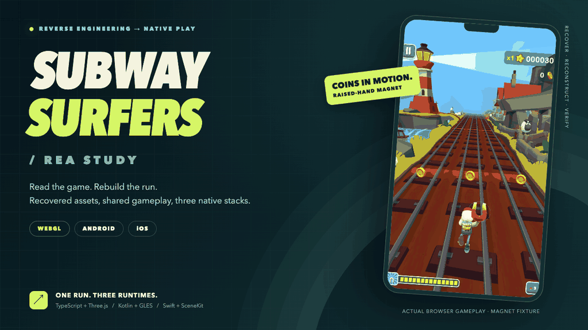
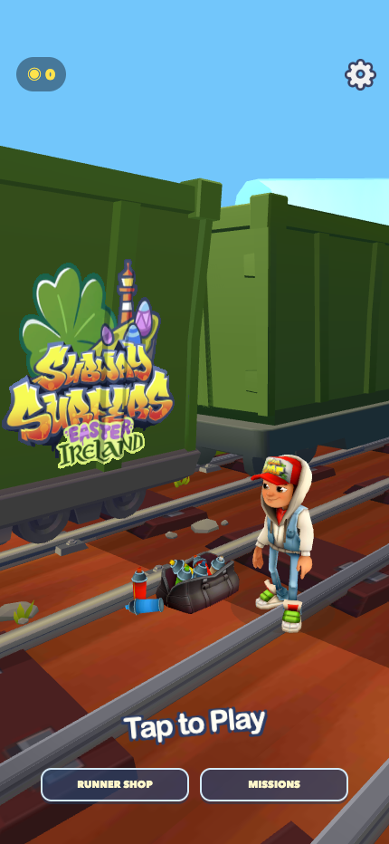
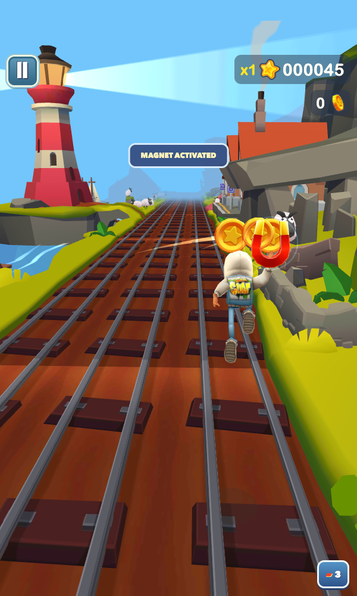
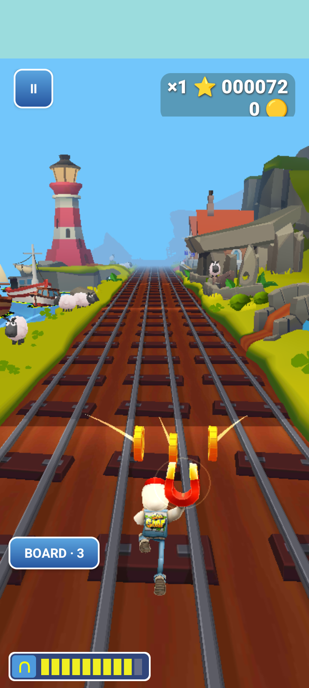
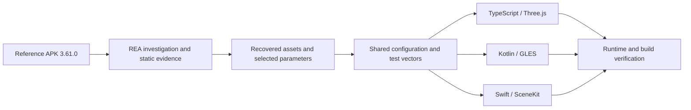

<p align="center">
  <picture>
    <source media="(prefers-reduced-motion: reduce)" srcset="docs/media/subway-rea-poster.png">
    
  </picture>
</p>

<h1 align="center">Subway Surfers / REA</h1>
<p align="center"><b>Read the game. Rebuild the run.</b><br>An unofficial reverse-engineering study across the browser, Android, and iOS.</p>
<p align="center">
  
  
  
</p>
<p align="center">
  <a href="https://uttkarshchambiyal.github.io/subway-surfers-rea/"><b>▶ Play online</b></a> · <a href="#play-the-builds">Downloads</a> · <a href="#inside-the-run">Features</a> · <a href="#run-from-source">Build it</a> · <a href="#how-it-was-rebuilt">REA study</a> · <a href="#what-was-verified">Verification</a>
</p>

---

A three-lane endless runner reconstructed using **REA-assisted investigation**, recovered **Subway Surfers 3.61.0** assets, and native implementations for each platform. Jake runs through the Ireland environment with the recovered character meshes, textures, audio and animation clips, while shared configuration keeps the three gameplay engines aligned.

The project combines recovered evidence with original integration work. Route assembly, parts of collision and camera behavior, menus, economy, and presentation effects are reconstructed. It does **not** claim to reproduce the complete original Unity game. See the [fidelity report](docs/revision/recovered-build.md).

## Play the builds

### [▶ Play Subway Surfers / REA in your browser](https://uttkarshchambiyal.github.io/subway-surfers-rea/)

Open the hosted game directly—no download or local server needed. Keyboard and touch controls are supported. GitHub Pages rebuilds the game from `main` after each push.

**[Open the latest release →](https://github.com/Uttkarshchambiyal/subway-surfers-rea/releases/latest)**

| Platform | Download | How to run |
| --- | --- | --- |
| **Play online** | [Hosted browser game](https://uttkarshchambiyal.github.io/subway-surfers-rea/) | Open the link and tap **Play**. |
| **Browser** | [Offline game ZIP](https://github.com/Uttkarshchambiyal/subway-surfers-rea/releases/latest/download/RailRush-web-offline.zip) | Extract, then run `python3 play.py`. macOS and Windows launchers are included. |
| **Android** | [Debug APK](https://github.com/Uttkarshchambiyal/subway-surfers-rea/releases/latest/download/RailRush-debug.apk) | Install on Android 8 / API 26 or newer. Launcher name: **Rail Rush**. |
| **iOS Simulator** | [arm64 Simulator app ZIP](https://github.com/Uttkarshchambiyal/subway-surfers-rea/releases/latest/download/RailRush-Simulator-arm64.zip) | Extract and install `RailRush.app` into a compatible arm64 iOS Simulator. |
| **Editable project** | [Source ZIP](https://github.com/Uttkarshchambiyal/subway-surfers-rea/releases/latest/download/RailRush-editable-source.zip) | Browser, Kotlin and Swift sources, shared assets, recovery scripts, and documentation. |

The downloaded browser ZIP runs from a **local HTTP server**, rather than by double-clicking `index.html`. After its first successful load, the production version can reload offline at the same address. Save data belongs to the exact hostname and port; hosted and local copies keep separate saves.

The iOS download is an **unsigned Simulator build**. It is not an iPhone IPA or App Store release; physical-device signing and testing are not supplied.

## Inside the run

- **Three tracks, one rhythm.** Swipe or use the keyboard to change lanes, jump, roll, climb ramps and run across train roofs.
- **A magnet you can see.** Jake raises the magnet in his hand. Coins arc in from all three tracks, spin with gold trails, and count when they reach it. An arrival pulse completes the effect.
- **Stackable powers.** Magnet, jetpack, super sneakers, score multiplier and hoverboard timers coexist. A board absorbs one crash.
- **Recovered character work.** The browser uses 37 recovered clips, a skinned sneaker mesh, an animated board attachment and a torso-following jetpack. Native bakes include the recovered clips and six reconstructed magnet-pose variants.
- **Local progression.** Coins, outfits, boards, missions, best score, mute and volume persist locally.
- **Offline by design.** No account, ads, billing, cloud service, paid API or online leaderboard.

<table>
  <tr>
    <td align="center"><br><b>The recovered world</b><br>Browser menu</td>
    <td align="center"><br><b>Coins in motion</b><br>Browser magnet fixture</td>
    <td align="center"><br><b>Native Android</b><br>GLES emulator fixture</td>
  </tr>
</table>

The animated banner and magnet screenshots are controlled gameplay fixtures captured from this project. They demonstrate presentation and collection behavior; they are not an unmodified natural playthrough or iOS runtime footage. [Static banner](docs/media/subway-rea-poster.png) · [Editable banner](docs/media/readme-scene.html).

## Run from source

### Browser

Use Python 3 and a Node version supported by the included Vite package; Node 22.12+ is suitable.

```sh
git clone https://github.com/Uttkarshchambiyal/subway-surfers-rea.git
cd subway-surfers-rea

python3 scripts/recovery/stage-assets.py
npm --prefix apps/web ci
npm --prefix apps/web run dev
```

For the production/offline build:

```sh
npm --prefix apps/web test
npm --prefix apps/web run build
npm --prefix apps/web run preview -- --host 127.0.0.1 --port 8175
```

Open the address printed by Vite. The production preview is `http://127.0.0.1:8175/` with the command above.

### Android

Requires JDK 17+, Android SDK 36, and Gradle dependencies. Configure your SDK in the ignored `apps/android/local.properties` or through your Android environment.

```sh
python3 scripts/recovery/stage-assets.py
cd apps/android
./gradlew assembleDebug testDebugUnitTest
adb install -r app/build/outputs/apk/debug/app-debug.apk
```

Once dependencies are cached, `./gradlew --offline assembleDebug testDebugUnitTest` also works. [Android notes](apps/android/README.md).

### iOS

Requires macOS, Xcode, and an installed iOS Simulator runtime to execute the app. The project targets iOS 17+.

```sh
python3 scripts/recovery/stage-assets.py
./apps/ios/test-engine.sh
./apps/ios/build-simulator.sh
open apps/ios/RailRush.xcodeproj
```

Choose **RailRush** and a compatible Simulator in Xcode. With a Simulator booted, you can also install the packaged app with `xcrun simctl install booted /path/to/RailRush.app`. [iOS notes](apps/ios/README.md).

## Controls

| Action | Keyboard | Touch / native app |
| --- | --- | --- |
| Change lanes | `←` / `→`, `A` / `D` | Swipe left / right |
| Jump | `↑`, `W`, `Space` | Swipe up |
| Roll / dive | `↓`, `S` | Swipe down |
| Hoverboard | `B` | Double-tap or board button |
| Pause | `P`, `Escape` | Pause button |

Backgrounding pauses the run. Resuming requires an explicit action.

## How it was rebuilt



| Layer | What lives here |
| --- | --- |
| `apps/web/` | TypeScript engine, Three.js renderer, browser UI, audio and offline worker |
| `apps/android/` | Native Kotlin engine, GLES renderer and Android UI |
| `apps/ios/` | Swift engine, SceneKit renderer and SwiftUI app |
| `shared/config/` | Shared movement, powers, camera and deterministic route data |
| `shared/recovered/` | Canonical recovered assets, manifests and native render bake |
| `shared/spec/` + `shared/test-vectors/` | Behavior contract and comparable simulation scenarios |
| `scripts/recovery/` | Asset conversion, native baking and resource staging |
| `docs/` | REA evidence, fidelity boundaries, implementation notes and retained verification reports |

Generated staging copies, dependency caches, original APKs, analysis binaries and local SDK paths are excluded from Git. The canonical assets needed for normal builds are included; `stage-assets.py` recreates the platform resource directories. Re-running the original recovery requires separately available reference material and tooling.

[Investigation](docs/investigation.md) · [Evidence ledger](docs/evidence-ledger.md) · [Reference parameters](docs/revision/reference-parameters.md) · [Asset provenance](docs/asset-provenance.md) · [Shared behavior](shared/spec/behavior.md).

## What was verified

Evidence from the **21 October 2026 magnet release**:

| Check | Result | Boundary |
| --- | --- | --- |
| Browser unit tests | **43 passed** | Engine, controls, persistence, geometry, audio and offline behavior |
| Production browser suite | **10 sections passed** | 30 seconds of keyboard play, touch, power fixtures, offline reload, persistence and responsive rendering |
| Browser soak | **600 simulated seconds** | Geometry count stayed at 59; accelerated fixture with collision grace |
| Magnet visual fixtures | **Passed** | Desktop and portrait browser views; actual body size, curved flights, pause, expiry, moving hand and once-only credit |
| Jetpack placement | **72 pose samples passed** | Anatomical attachment across recovered flight clips |
| Android engine | **21 tests passed** | JVM engine checks |
| Android runtime | **Emulator checks passed** | Native GLES coin-flight captures; no physical-phone claim |
| Swift engine | **44 checks passed** | Foundation engine executed on macOS |
| iOS app | **Simulator build passed** | Runtime unverified: no iOS Simulator runtime was installed on the build host |
| Shared scenario | **154 comparisons, zero difference** | Seven deterministic samples per platform with collision grace |

[Retained reports](docs/verification/) · [Magnet implementation and evidence](docs/revision/magnet-attraction.md) · [Production QA](docs/revision/production-qa.md) · [Known issues](docs/known-issues.md).

## Credits and scope

This is an **unofficial educational reconstruction**, not an official Subway Surfers product. Subway Surfers and its recovered characters, artwork, animation and audio belong to their respective owners, including SYBO and Kiloo. Their presence here does not grant a new license to that material. [Third-party notices](THIRD_PARTY_NOTICES.md).

REA supported the investigation; Three.js, Kotlin/GLES and Swift/SceneKit power the reconstructed runtimes. Recovery and reconstruction are documented separately so that screenshots, tests and build success are not mistaken for complete original-game fidelity.

---

<p align="center"><b>Recover the evidence. Reconstruct the behavior. Verify the run.</b><br><sub>Built as a practical study of reverse engineering, rendering and cross-platform game systems.</sub></p>
